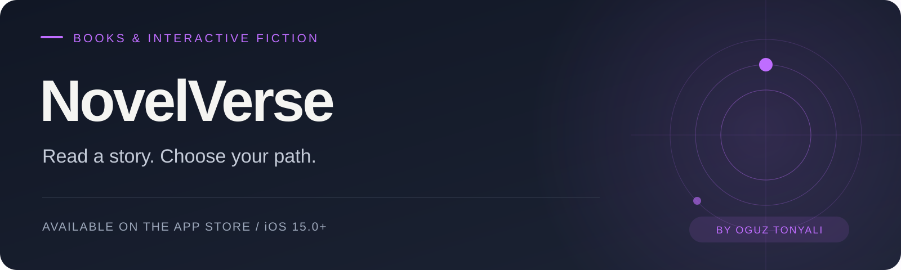
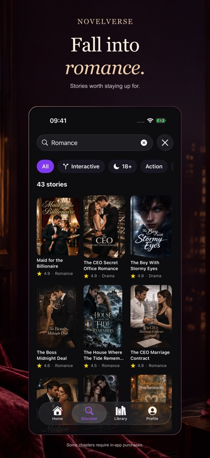
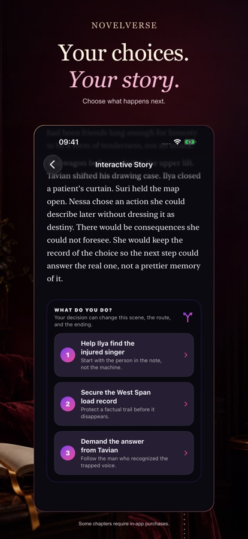
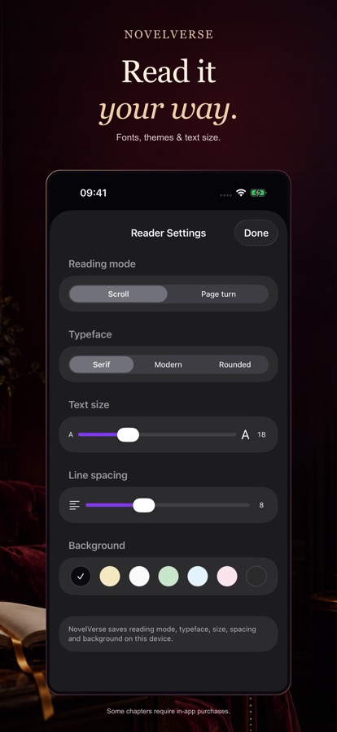

  <a href="https://apps.apple.com/us/app/novelverse-romance-novels/id6759668090"><strong>View on the App Store ↗</strong></a> &nbsp; · &nbsp;
  <a href="docs/ENGINEERING.md">Engineering notes</a> &nbsp; · &nbsp;
  <a href="https://github.com/Zodomik">More by Oğuz Tonyalı</a>

## NovelVerse

A native reading app for romance, fantasy and interactive fiction. Discover a novel, settle into a personalized reader, or make choices that shape a story’s route and ending.

Built and published by **[Oğuz Tonyalı](https://github.com/Zodomik)**. This repository is a public product and engineering showcase; the application source is maintained privately.

## A look inside

  
  
  

*Official product previews from the [App Store listing](https://apps.apple.com/us/app/novelverse-romance-novels/id6759668090).*

## What you can do

- Genre discovery, search, personal library and reading progress.
- Interactive stories with choices, branching routes and different endings.
- Adjustable fonts, text size and reading themes.
- Token-based chapter unlocks and Pro subscriptions.

## Technology

| Area | Technologies | Role in the product |
| --- | --- | --- |
| iOS | Swift, SwiftUI, UIKit | Native discovery screens, reader and page transitions. |
| Application state | Combine, Foundation | Shared app state and asynchronous API-driven content. |
| Identity | AuthenticationServices, Google Sign-In, Keychain | Apple/Google sign-in and protected session-token storage. |
| Purchases | StoreKit 2, RevenueCat | Consumable token purchases, subscriptions and restoration. |
| Backend | TypeScript, NestJS, Prisma, PostgreSQL | Content, accounts, reading progress and chapter access. |

## Engineering highlights

### A reader with its own interaction model

Reading controls, typography, chapter navigation and cached content are separated from discovery and account flows. SwiftUI works alongside UIKit for native reading interactions.

### Choices as application state

The interactive reader handles decisions and story progression alongside the conventional chapter reader. This gives the same product room for both linear and branching fiction.

### A complete product boundary

The native client connects to a typed server and relational data model. Authentication, chapter access and purchase handling are separate responsibilities rather than screen-level concerns.

→ **[Explore the architecture and design decisions](docs/ENGINEERING.md)**

## Try the product

**[Open NovelVerse on the App Store](https://apps.apple.com/us/app/novelverse-romance-novels/id6759668090)** · Requires iOS 15.0 or later.

Availability and purchase options are shown in the store. For product support, use the developer links on the App Store listing.

---

[All published apps](https://apps.apple.com/us/developer/oguz-tonyali/id1880078720) · [Developer profile](https://github.com/Zodomik) · [Media credits](assets/SOURCES.md)
