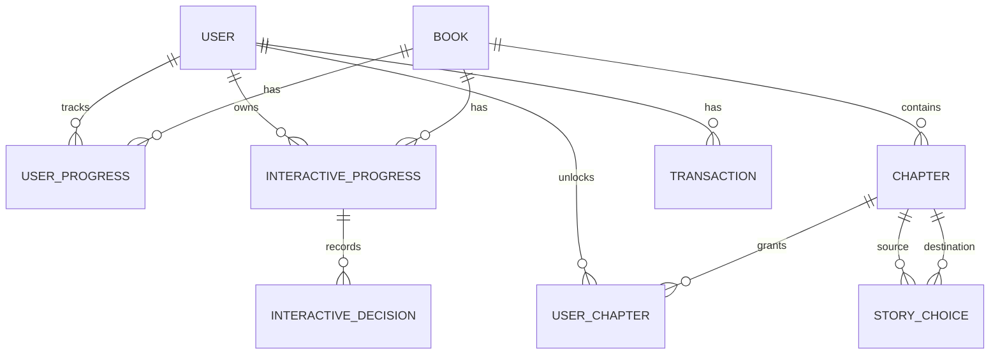

# NovelVerse · Data model

**Durable server storage:** PostgreSQL, accessed through Prisma. **Device storage:** Keychain for session credentials, JSON files for cached chapters, and local preferences. The tables below summarize the schema rather than reproduce its full DDL.

## Main entities

| Entity | Purpose and important relationships |
| --- | --- |
| User | Account/guest identity, token balance and subscription status; owns progress and purchase records |
| Book | Catalog metadata, publication state, story type, interactive start node and JSON configuration |
| Chapter | Belongs to a book; stores text, ordering, content version, scene number and optional ending marker |
| StoryChoice | Directed edge between two chapters; localized label, JSON requirements/effects and display order |
| InteractiveProgress | One route state per user/book; current node, JSON story state, completion and restart count |
| InteractiveDecision | Ordered choice history, source/destination nodes, applied effects and request ID |
| UserChapter | A user’s durable chapter unlock |
| UserProgress | Linear reading position, last chapter and accumulated reading time |
| UserBookMeta | Favorites, shelf status, vote and last-opened metadata |
| Transaction | Token movements and purchase references; separate from the displayed balance |
| RevenueCatWebhookEvent | Event receipt and processing state for duplicate-aware subscription updates |
| HomeSection | Editorial homepage sections with ordered book IDs |

Additional entities cover pending registrations, refresh sessions, support tickets, push devices and notification jobs.

## Constraints that carry product rules

| Constraint / index | Why it matters |
| --- | --- |
| Unique chapter `(bookId, orderIndex)` and `(bookId, nodeKey)` | Stable order and story-node identity within a book |
| Unique choice `(fromChapterId, sortOrder)` | Unambiguous option ordering |
| Unique progress `(userId, bookId)` | One current progress record for a reader and book |
| Unique decision `requestId` and `(progressId, sequence)` | Duplicate request detection and ordered history |
| Unique unlock `(userId, chapterId)` | A durable unlock cannot be inserted twice |
| Unique transaction `(type, reference)` | Reused purchase references cannot create a second ledger row |
| Unique webhook `eventId` | Repeated delivery can be recognized |
| Indexes on book/scene order and user/shelf/favorite | Support story traversal, chapter lists and library queries |

## Relational structure plus story-specific JSON

Story choices form a directed graph over chapter rows. `storyState` holds scalar story variables such as a relationship score or a route flag. Requirements support nested logical expressions; effects can add to a numeric variable or set a value.

Illustrative example: a route begins with `trust = 1`; a choice adds 2; a later option requires `trust >= 3`. These are examples of the state model, not published story content.

One visible chapter may have several alternative scene rows. The unlock service resolves that group to a stable anchor, so choosing a different scene in the same chapter does not create a separate purchase unit.

## Cache and source of truth

The chapter cache uses `(chapter ID, locale)` as its file identity. It is disposable device storage. Account balance, chapter unlocks, route decisions and synchronized reading progress belong to PostgreSQL.

[Architecture](ENGINEERING.md) · [Algorithms](ALGORITHMS.md)
