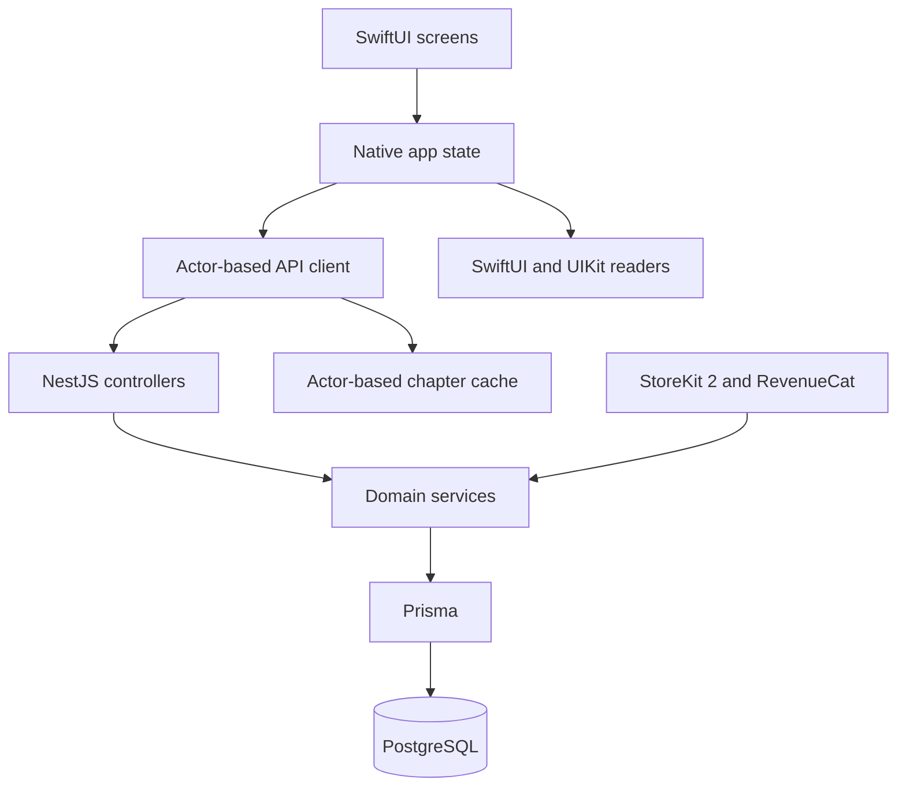

# NovelVerse · Architecture

*Implementation notes checked against the working project on 20 November 2026. Store builds may differ as the project evolves.*

NovelVerse combines a native iOS reader with a content and account backend. The same content system supports conventional chapters and interactive stories.

## Stack and responsibilities

| Layer | Technology | What it does here |
| --- | --- | --- |
| iOS interface | Swift, SwiftUI, UIKit | Discovery, library, account screens, interactive reader and page-curl reader |
| State and concurrency | Combine, Swift actors, async/await | Observable screen state, API operations and chapter cache |
| Text layout | TextKit: NSTextStorage, NSLayoutManager, NSTextContainer | Measures attributed text into pages using the available reading area |
| Network client | Foundation / URLSession | Typed requests, session refresh and content loading |
| Sign-in | AuthenticationServices, Google Sign-In, Security / Keychain | Apple and Google sign-in; session credentials stored in Keychain |
| Purchases | StoreKit 2, RevenueCat | Token packs, subscription access and restore flow |
| HTTP backend | TypeScript, NestJS, Express adapter | Controllers, dependency injection and domain services |
| Data | Prisma ORM, PostgreSQL | Books, chapter access, progress, decisions and transactions |
| Supporting modules | Passport/JWT, bcryptjs, class-validator, class-transformer, NestJS Throttler | Authentication, password hashing, request validation and request limits |

## Request flow

The backend is organized into modules for authentication, books, chapters, reading progress, user/library data, tokens, interactive stories, webhooks, notifications, support and administration. It is a modular application; these modules are not separate deployed microservices.

## Reading and account state

`NativeAppState` coordinates the catalog, session and reading-related data. `NVAPIClient` is an actor rather than a collection of networking calls inside views. When several authenticated requests need a session refresh, they can await the same in-flight refresh task.

`NVChapterCache` is another actor. It serializes chapter content as JSON in the device cache directory, with the chapter ID and locale in the filename. Writes are atomic. This is a cache of previously retrieved content, separate from the server’s durable reading and purchase records.

The page reader converts normalized chapter text into attributed text, asks TextKit for the character range that fits each page, then presents those pages through `UIPageViewController`. The scrolling reader and interactive reader share the product shell but have different interaction models.

## Backend and database boundaries

- Book and chapter services prepare localized catalog/content responses and check reading access.
- Interactive services validate story graphs, evaluate choice conditions and persist each reader’s route.
- Token services request transaction information from Apple before recording a token-pack purchase.
- RevenueCat webhook handling updates subscription state separately from consumable-token accounting.
- Admin modules manage content, home sections and interactive graphs; the native reader consumes their published data.

The database is relational, with JSON fields where story-specific flexibility is useful. For example, a choice has ordinary foreign keys for its source and destination, while its requirements/effects are JSON. This keeps navigation queryable without requiring a new SQL column for each story variable.

## An example: making a choice

The client submits a choice and a request identifier. The server checks that the choice belongs to the reader’s current node, evaluates requirements against saved state, checks chapter access, applies effects and advances progress in a transaction. A decision row records the transition and sequence. Retrying the same request can return the already-applied result.

This is separate from unlocking a paid chapter. In an interactive story, several scene nodes can belong to the same visible chapter; the unlock model groups those scenes under a stable chapter anchor.

## Code landmarks

`NativeAPIClient`, `NativeAppState`, `NVChapterCache`, `NVReaderPaginator`, `InteractiveService`, `ChaptersService`, `TokensService`, `RevenueCatWebhookService`, and the Prisma schema.

**Continue:** [Data model](DATA_MODEL.md) · [Algorithms and implementation choices](ALGORITHMS.md) · [Product](../README.md)
