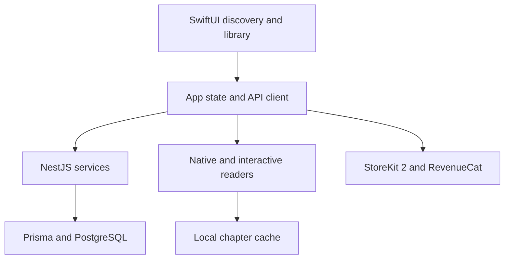

# NovelVerse · Engineering notes

This overview describes the product’s implementation at a component level. It accompanies the [product showcase](../README.md).

## Component map

The diagram emphasizes responsibilities and data flow. Platform integrations can have their own independent lifecycle.

## Design decisions

### A reader with its own interaction model

Reading controls, typography, chapter navigation and cached content are separated from discovery and account flows. SwiftUI works alongside UIKit for native reading interactions.

### Choices as application state

The interactive reader handles decisions and story progression alongside the conventional chapter reader. This gives the same product room for both linear and branching fiction.

### A complete product boundary

The native client connects to a typed server and relational data model. Authentication, chapter access and purchase handling are separate responsibilities rather than screen-level concerns.

## Stack reference

| Area | Technologies | Responsibility |
| --- | --- | --- |
| iOS | Swift, SwiftUI, UIKit | Native discovery screens, reader and page transitions. |
| Application state | Combine, Foundation | Shared app state and asynchronous API-driven content. |
| Identity | AuthenticationServices, Google Sign-In, Keychain | Apple/Google sign-in and protected session-token storage. |
| Purchases | StoreKit 2, RevenueCat | Consumable token purchases, subscriptions and restoration. |
| Backend | TypeScript, NestJS, Prisma, PostgreSQL | Content, accounts, reading progress and chapter access. |

## Scope

The technology summary was checked against the application’s Swift imports, project configuration and relevant service/model implementations. Backend technologies, where listed, were checked against the associated package manifest and database schema. Store screenshots illustrate the released product; the private working project may continue evolving after release.

This documentation publishes no credentials, deployment configuration, private endpoints or application source. Product behavior and supported devices are described in the [current App Store listing](https://apps.apple.com/us/app/novelverse-romance-novels/id6759668090).
